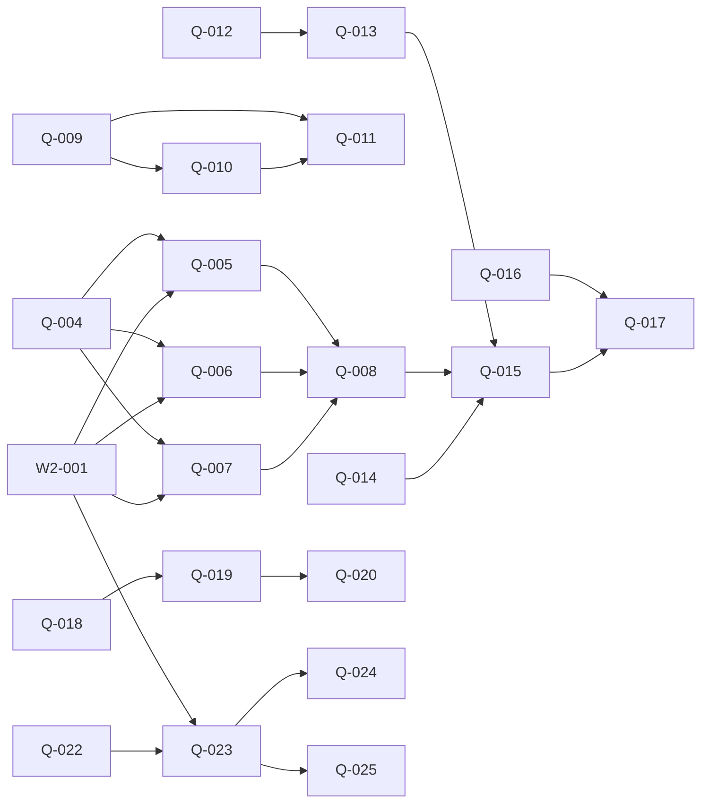

# 决策记录

## 2026-11-13 · 路线图拆解的边界与门禁接续（本轮规划决策）

- **决策**：Q-002/Q-003 保留为 blocked 汇总，由后继卡执行，不重复认领；W2-002 已标 Merged，不重开实现单。W2-001 仍是外部依赖，不擅自宣布合入。
- **理由**：路线图与当前单据状态不同步；保留来源与完成标志，避免平行派出重复工作。
- **被否掉的方案**：按旧路线图重做 App 注册、G5 扫描器；把旧汇总单和新子单同时设为 ready。

- **决策**：G8 输入→三页独立标定→一周 advisory→限定页面阻塞；沿用 G5→G8→G6 顺序。G0 保持仅新模块 advisory，不加入全局阻塞。
- **理由**：冻结协议明确 G0 的适用范围；标定和执行器绿色不能替代观察期或真实页面到达证据。
- **被否掉的方案**：标定一次立即全局阻塞、默认 hash 已是可用路由、把单测通过当作真机采集通过。

- **决策**：共享 runner 与 Settings 主壳写入集中串行；其他页面/spec/离线工具可并行。49测试、31页及两个巨型组件先生成真实边界清单，再产出每卡≤半天的实现卡；本轮不宣称这些尾项已穷尽拆解。
- **理由**：旧数量与文件归属未核定，直接均分会编造工作量并制造同文件冲突；小样迁移先验证接口。
- **被否掉的方案**：按估算个数平分成 M、一次迁完所有页、把只读清点的验收冒充功能完成。

- **决策**：本轮仅文档结构检查，不运行构建、e2e、全量单测；卡片的验收由执行者运行，未来新增的测试明确标注。
- **理由**：符合本轮成本与角色授权；规划产物与实现通过是两件事。
- **被否掉的方案**：规划轮预跑全量门禁、虚填通过记录。

### 后继依赖图与建议顺序

建议先开 Q-009（脚本盘点），并行 Q-004（真机输入）、Q-012（G5观察）、Q-014（G6登记观察）、Q-016（G0离线）、Q-018（C5复现）、Q-022（测试清单）、Q-026/Q-027（组件边界）。Q-021 耗时基线由门禁执行者承担。Q-023 依赖 W2-001 和 Q-022，之后 Q-024/Q-025 涉主壳处须持同一锁串行。Q-013、Q-008、Q-015 均涉及共享门禁接线，由集成者串行安排。

本轮新增24张（Q-004–Q-027）；尚未穷尽拆解的尾项是清单驱动的测试改造、剩余页面迁移、脚本逐簇迁移、首页其余分组与两个组件的实际提取卡；由对应清点单交付真实清单后继续，不预造数量。
