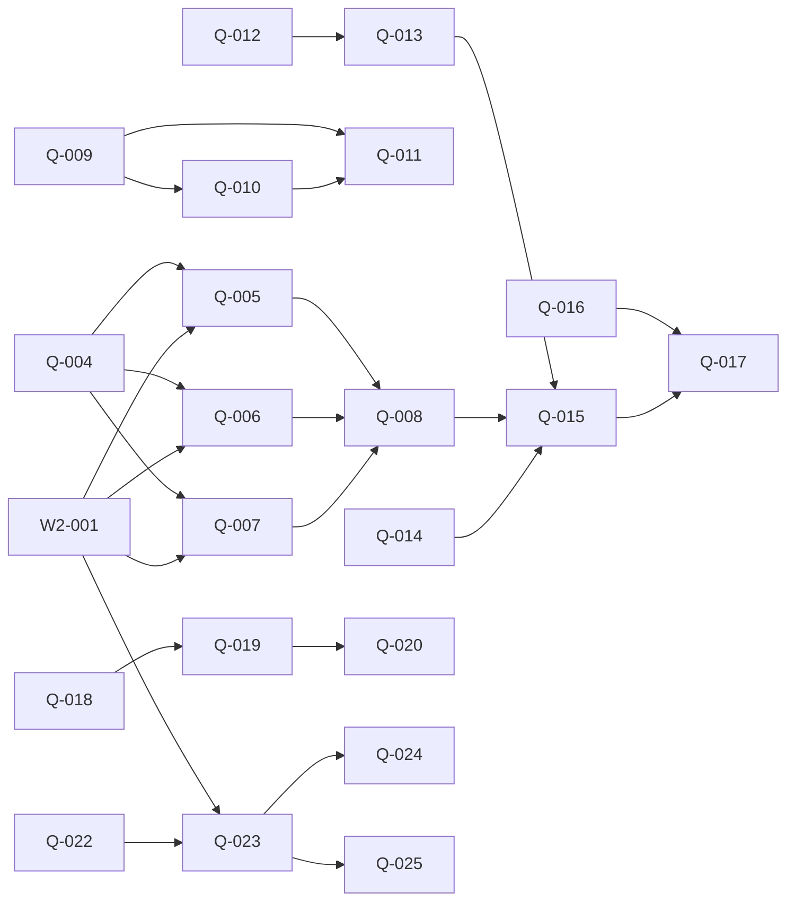

# 架构与协作决策记录 (Decisions Log)

## 2026-11-13 · 决策一：Codex 主导规划与协作拓扑确立

- **背景与授权**：用户已明确授权，由 Codex 主导技术方案设计、任务拆解与优先级排序，并直接向 Workbuddy、Antigravity、DSH 派发工单，不再通过用户人工传递消息。
- **角色权责边界**：
  1. **Codex（规划者与审查者）**：负责全局架构决策、任务规划、复杂缺陷根因定位与交付前审查；不承担繁琐的重复实现，不直接向 `main` 分支提交业务代码。
  2. **Antigravity（集成者）**：独占 `main` 分支集成、门禁终审、流水线治理与共享结构层管理。
  3. **DSH（基建与真机采集）**：独占门禁工具链演进、断言溯源以及**唯一的 Android 真机连接、采集与保活**。
  4. **Workbuddy（构建者）**：依据工单和采集包并行实施具体业务页面与子页复刻。
- **真机协同原则**：
  - 由 DSH 统筹物理真机，负责提取并生成标准几何数据包（`spec/*.geometry.json`）与布局快照；
  - Workbuddy 与 Antigravity 仅消费数据包进行几何对齐与自动化回归，严禁多方抢夺物理 ADB 设备连接。
- **临时授权与大锁解绑**：
  - 为避免 `scripts/**` 目录级别大锁阻塞 Workbuddy 工作，特批 Workbuddy 对 `scripts/gen-task-board.mjs`、`tests/pipelineQueue.test.js`、`scripts/legacy/**` 以及未注册验证脚本分类清单的明确临时独占修改权。
  - DSH 独占核心门禁与棘轮脚本：`scripts/gate-merge.mjs`、`scripts/check-assert-ratchet.mjs`、`scripts/claim-check.mjs`、`scripts/lib/claim-rules.mjs` 及 `tests/pipeline*`。
- **复刻与重构解耦**：
  - 后续设置项页级深度复刻依循页面自声明注册机制推进，不依赖主壳全仓瘦身（主壳瘦身明确划入后续 W4 阶段）。
  - `SettingsApp.vue` 独占锁已由 Workbuddy 于 W2-001 合并后正式归还 Integrator。

---

## 2026-11-13 · 决策二：SET-01 业务定案与浏览器重测试租约机制

- **背景**：针对当前系统负载高达 40+ 的硬件资源瓶颈，以及多 lane 并行跑单测（包含 Headless Chrome / Playwright）造成严重时序冲突与假失败的问题，确立以下调度与业务定案：
- **浏览器重测试租约机制**：
  1. **禁止全局 Kill**：严禁在排查或测试中使用全局 kill 影响其他 lane 的浏览器实例与进程。
  2. **串行调度租约**：重测试严格按租约串行流转，当前顺序为：**Antigravity 结束当前 gate 释放租约 → Workbuddy 独占测试运行 → DSH 独占**。
  3. **代码并行开发**：代码实现与改动完全并行，仅在本地需要跑包含 Headless Chrome 的测试时遵循租约。
  4. **缺陷定位分工**：`transitionContract.test.js` 的时序等待问题（因异步组件未挂载引发的 500ms 短等待失败）统一交由 Workbuddy 修复，Antigravity 只交付失败日志与时序特征，不重复改动。
- **SET-01 设置深度复刻实施路线**：
  1. **DSH 优先链路**：USB 供电保活真机，完成显示、声音、无障碍三页 G8 标定，随后依次提取并交付「日期与时间」、「安全和紧急情况」、「用户与账号」真实真机 XML 与截图数据包（`SET-DSH-01`）。
  2. **Workbuddy 实施链路**：接收日期与时间采集包，实现系统与日期时间全流程复刻（`SET-WB-01`），并顺带解决 `transitionContract.test.js` 的时序收敛。
  3. **Antigravity 实施链路**：完成基建 P0 流水线收口后，基于采集包复刻安全与紧急情况、用户与账号（`SET-AG-01`），Google 服务暂缓；负责 Settings 主壳单点最小接线。
  4. **业务红线**：叶子页与控件范围严格以真机证据为准，未验证项一律标注 unknown；严禁触发真实 SOS 呼叫，严禁改写系统真实账户。

---

## 2026-11-13 · 决策三：路线图拆解的边界与门禁接续（Codex 规划决策）

- **决策**：Q-002/Q-003 保留为 blocked 汇总，由后继卡执行，不重复认领；W2-002 已标 Merged，不重开实现单。W2-001 仍是外部依赖，不擅自宣布合入。
- **理由**：路线图与当前单据状态不同步；保留来源与完成标志，避免平行派出重复工作。
- **被否掉的方案**：按旧路线图重做 App 注册、G5 扫描器；把旧汇总单和新子单同时设为 ready。

- **决策**：G8 输入→三页独立标定→一周 advisory→限定页面阻塞；沿用 G5→G8→G6 顺序。G0 保持仅新模块 advisory，不加入全局阻塞。
- **理由**：冻结协议明确 G0 的适用范围；标定和执行器绿色不能替代观察期或真实页面到达证据。
- **被否掉的方案**：标定一次立即全局阻塞、默认 hash 已是可用路由、把单测通过当作真机采集通过。

- **决策**：共享 runner 与 Settings 主壳写入集中串行；其他页面/spec/离线工具可并行。49测试、31页及两个巨型组件先生成真实边界清单，再产出每卡≤半天的实现卡；本轮不宣称这些尾项已穷尽拆解。
- **理由**：旧数量与文件归属未核定，直接均分会编造工作量并制造同文件冲突；小样迁移先验证接口。
- **被否掉的方案**：按估算个数平分成 M、一次迁完所有页、把只读清点的验收冒充功能完成。

- **决策**：本轮仅文档结构检查，不运行构建、e2e、全量单测；卡片的验收由执行者运行，未来新增的测试明确标注。
- **理由**：符合本轮成本与角色授权；规划产物与实现通过是两件事。
- **被否掉的方案**：规划轮预跑全量门禁、虚填通过记录。

### 后继依赖图与建议顺序

建议先开 Q-009（脚本盘点），并行 Q-004（真机输入）、Q-012（G5观察）、Q-014（G6登记观察）、Q-016（G0离线）、Q-018（C5复现）、Q-022（测试清单）、Q-026/Q-027（组件边界）。Q-021 耗时基线由门禁执行者承担。Q-023 依赖 W2-001 和 Q-022，之后 Q-024/Q-025 涉主壳处须持同一锁串行。Q-013、Q-008、Q-015 均涉及共享门禁接线，由集成者串行安排。

本轮新增 24 张（Q-004–Q-027）；尚未穷尽拆解的尾项是清单驱动的测试改造、剩余页面迁移、脚本逐簇迁移、首页其余分组与两个组件的实际提取卡；由对应清点单交付真实清单后继续，不预造数量。
