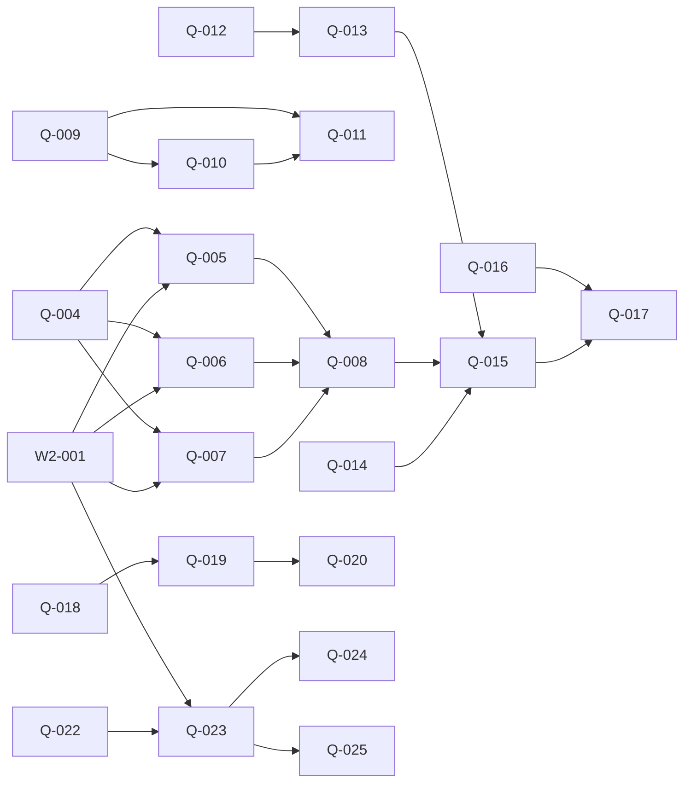

# 架构与协作决策记录 (Decisions Log)

## 2026-11-13 · 决策一：Codex 主导规划与协作拓扑确立

- **背景与授权**：用户已明确授权，由 Codex 主导技术方案设计、任务拆解与优先级排序，并直接向 Workbuddy、Antigravity、DSH 派发工单，不再通过用户人工传递消息。
- **角色权责边界**：
  1. **Codex（规划者与审查者）**：负责全局架构决策、任务规划、复杂缺陷根因定位与交付前审查；不承担繁琐的重复实现，不直接向 `main` 分支提交业务代码。
  2. **Antigravity（集成者）**：独占 `main` 分支集成、门禁终审、流水线治理与共享结构层管理。
  3. **DSH（基建与真机采集）**：独占门禁工具链演进、断言溯源以及**唯一的 Android 真机连接、采集与保活**。
  4. **Workbuddy（构建者）**：依据工单和采集包并行实施具体业务页面与子页复刻。
- **真机协同原则**：
  - 由 DSH 统筹物理真机，负责提取并生成标准几何数据包（`spec/*.geometry.json`）与布局快照；
  - Workbuddy 与 Antigravity 仅消费数据包进行几何对齐与自动化回归，严禁多方抢夺物理 ADB 设备连接。
- **临时授权与大锁解绑**：
  - 为避免 `scripts/**` 目录级别大锁阻塞 Workbuddy 工作，特批 Workbuddy 对 `scripts/gen-task-board.mjs`、`tests/pipelineQueue.test.js`、`scripts/legacy/**` 以及未注册验证脚本分类清单的明确临时独占修改权。
  - DSH 独占核心门禁与棘轮脚本：`scripts/gate-merge.mjs`、`scripts/check-assert-ratchet.mjs`、`scripts/claim-check.mjs`、`scripts/lib/claim-rules.mjs` 及 `tests/pipeline*`。
- **复刻与重构解耦**：
  - 后续设置项页级深度复刻依循页面自声明注册机制推进，不依赖主壳全仓瘦身（主壳瘦身明确划入后续 W4 阶段）。
  - `SettingsApp.vue` 独占锁已由 Workbuddy 于 W2-001 合并后正式归还 Integrator。

---

## 2026-11-13 · 决策二：SET-01 业务定案与浏览器重测试租约机制

- **背景**：针对当前系统负载高达 40+ 的硬件资源瓶颈，以及多 lane 并行跑单测（包含 Headless Chrome / Playwright）造成严重时序冲突与假失败的问题，确立以下调度与业务定案：
- **浏览器重测试租约机制**：
  1. **禁止全局 Kill**：严禁在排查或测试中使用全局 kill 影响其他 lane 的浏览器实例与进程。
  2. **串行调度租约**：重测试严格按租约串行流转，当前顺序为：**Antigravity 结束当前 gate 释放租约 → Workbuddy 独占测试运行 → DSH 独占**。
  3. **代码并行开发**：代码实现与改动完全并行，仅在本地需要跑包含 Headless Chrome 的测试时遵循租约。
  4. **缺陷定位分工**：`transitionContract.test.js` 的时序等待问题（因异步组件未挂载引发的 500ms 短等待失败）统一交由 Workbuddy 修复，Antigravity 只交付失败日志与时序特征，不重复改动。
- **SET-01 设置深度复刻实施路线**：
  1. **DSH 优先链路**：USB 供电保活真机，完成显示、声音、无障碍三页 G8 标定，随后依次提取并交付「日期与时间」、「安全和紧急情况」、「用户与账号」真实真机 XML 与截图数据包（`SET-DSH-01`）。
  2. **Workbuddy 实施链路**：接收日期与时间采集包，实现系统与日期时间全流程复刻（`SET-WB-01`），并顺带解决 `transitionContract.test.js` 的时序收敛。
  3. **Antigravity 实施链路**：完成基建 P0 流水线收口后，基于采集包复刻安全与紧急情况、用户与账号（`SET-AG-01`），Google 服务暂缓；负责 Settings 主壳单点最小接线。
  4. **业务红线**：叶子页与控件范围严格以真机证据为准，未验证项一律标注 unknown；严禁触发真实 SOS 呼叫，严禁改写系统真实账户。

---

## 2026-11-13 · 决策三：路线图拆解的边界与门禁接续（Codex 规划决策）

- **决策**：Q-002/Q-003 保留为 blocked 汇总，由后继卡执行，不重复认领；W2-002 已标 Merged，不重开实现单。W2-001 仍是外部依赖，不擅自宣布合入。
- **理由**：路线图与当前单据状态不同步；保留来源与完成标志，避免平行派出重复工作。
- **被否掉的方案**：按旧路线图重做 App 注册、G5 扫描器；把旧汇总单和新子单同时设为 ready。

- **决策**：G8 输入→三页独立标定→一周 advisory→限定页面阻塞；沿用 G5→G8→G6 顺序。G0 保持仅新模块 advisory，不加入全局阻塞。
- **理由**：冻结协议明确 G0 的适用范围；标定和执行器绿色不能替代观察期或真实页面到达证据。
- **被否掉的方案**：标定一次立即全局阻塞、默认 hash 已是可用路由、把单测通过当作真机采集通过。

- **决策**：共享 runner 与 Settings 主壳写入集中串行；其他页面/spec/离线工具可并行。49测试、31页及两个巨型组件先生成真实边界清单，再产出每卡≤半天的实现卡；本轮不宣称这些尾项已穷尽拆解。
- **理由**：旧数量与文件归属未核定，直接均分会编造工作量并制造同文件冲突；小样迁移先验证接口。
- **被否掉的方案**：按估算个数平分成 M、一次迁完所有页、把只读清点的验收冒充功能完成。

- **决策**：本轮仅文档结构检查，不运行构建、e2e、全量单测；卡片的验收由执行者运行，未来新增的测试明确标注。
- **理由**：符合本轮成本与角色授权；规划产物与实现通过是两件事。
- **被否掉的方案**：规划轮预跑全量门禁、虚填通过记录。

### 后继依赖图与建议顺序

建议先开 Q-009（脚本盘点），并行 Q-004（真机输入）、Q-012（G5观察）、Q-014（G6登记观察）、Q-016（G0离线）、Q-018（C5复现）、Q-022（测试清单）、Q-026/Q-027（组件边界）。Q-021 耗时基线由门禁执行者承担。Q-023 依赖 W2-001 和 Q-022，之后 Q-024/Q-025 涉主壳处须持同一锁串行。Q-013、Q-008、Q-015 均涉及共享门禁接线，由集成者串行安排。

本轮新增 24 张（Q-004–Q-027）；尚未穷尽拆解的尾项是清单驱动的测试改造、剩余页面迁移、脚本逐簇迁移、首页其余分组与两个组件的实际提取卡；由对应清点单交付真实清单后继续，不预造数量。

---

## 2026-11-24 · 1280×2200 新产品形态迁移提案

### 屏幕规格

新形态与现有形态共用应用注册、路由、组件、状态与数据。根屏幕按当前机型提供逻辑尺寸、安全区、屏幕圆角和开孔。沿用同一个原型地址，在桌面侧栏及移动抽屉的控制台提供「机型」选择，原地切换现有机型和 1280×2200 机型。

| 项目 | 旧机型 | 新机型 |
| --- | --- | --- |
| 3× 设计／导出尺寸 | 1080×2364（按桌面逻辑画布换算） | 1280×2200 |
| 逻辑画布 | 桌面 360×788，移动端沿用既有视口适配 | 1280÷3 × 2200÷3，即约 426.67×733.33 |
| 安全区、开孔、圆角 | 现有度量 | 由产品规格或真机确认 |

按 3× 计算，新画布比旧桌面画布宽约 18.5%、矮约 6.9%，比例为 32:55。用 1280、2200 和倍率 3 作为规格源，运行时以原始值除以 3。表格里的两位小数仅用于展示，绘制和手势计算保留小数。设计倍率独立于浏览器 DPR 和舞台缩放。旧机型的设计导出尺寸也独立于各真机采集的原始尺寸。新机型几何及硬件能力仍需确认有效屏区、安全区、开孔、默认字体比例、导航模式、键盘、方向要求、背屏与实体键的规格。

### 控制台实时切换

1. 控制台请求机型变化，舞台更新同一个屏幕根节点的 CSS 尺寸和安全区。新机型的桌面带壳和手机触控共用同一逻辑画布，通过外部等比缩放适配宿主容器。旧机型移动端继续沿用满屏适配。
2. 切换时保持 `ScreenView` 和当前应用实例挂载，沿用 Pinia、路由栈及存储键。保留当前页面、未提交的表单、应用数据、桌面排序、展开状态和滚动阅读位置。重排后优先按可见内容的锚点恢复滚动位置。当前能力如背屏在目标机型缺失时，展示正面并保留相关数据。
3. 已在进行的手势和动画在一致的状态下结束或取消，随后刷新 Hero 锚点、输入坐标和多任务预览尺寸。录屏或截图进行中暂缓切换并在选择器说明原因。机型作为控制台偏好保存，首次打开、无效机型或回退时使用现有机型。

### 坐标和布局

1. 物理像素用于真机采集和明确要求原生尺寸的输出。逻辑像素用于组件、手势和动画求解。宿主视口用于等比呈现画布和放置控制台，浏览器 DPR 只参与栅格化与媒体处理。输入与 DOM 量测统一转换到屏幕容器的局部坐标，一个事件只换算一次。换算读取屏幕自身布局尺寸和可视 rect，保留小数精度。新机型目标比例在支持的宿主上等比适配，宿主留白可出现在模拟屏幕外。
2. 复用现有屏幕引用、桌面网格 profile 和 CSS tokens。应用按自身容器的宽度和可用高度重排。列表和详情可随宽度增加内容区，使用合理的行宽上限。保留字号、方形图标和卡片、控件热区与交互。桌面和控制中心先利用增加的横向空间，高度不足时收紧弹性留白并使用页内滚动或分页。所有功能及末尾操作都须可达。密度、图标列数或信息优先级如需改变，由产品确认。
3. Hero、边缘滑动、返回、控制中心下拉和多任务卡片统一使用画布尺寸和实时锚点。连续手势中间帧、取消回弹、完成帧和层间交接都验收。锁屏壁纸、景深遮罩和前后景共用裁切锚点与比例。应用弹窗、键盘、底部面板明确引用模拟屏幕可用高。
4. 采样来源与运行机型分别记录。保留协议 §4 和现有来源到 360×788 的映射。对新机型使用独立目标 profile 和对应真机或设计规格。G8 按目标 profile 与容器实测缩放归一化，旧规格和旧容差保持。沿用现有标定流程，同栅格器做回归像素比对，真机与浏览器采用并排图和锚点核验。

旧画布分轴拉伸到新比例会改变图标和文字的形状，等比放大则会改变逻辑字号或裁掉内容。按 3× 换算后原地重排保留同一套度量和交互标尺。复制一套页面会增加状态与维护分歧。

### 验收和发布

- 开工时冻结集成基线 SHA。从真实应用注册、设置子路由、系统浮层、桌面／锁屏、背屏能力和控制台工具生成一份模块与场景清单，区分已实现、占位及按规格不适用。记录每条入口、核心操作、持久化和历史数据、异常／取消路径、双机型证据与归属卡。已有套件只覆盖其中一部分。没有覆盖的已实现功能补专用浏览器断言或可复验的人工流程。
- 旧机型在固定内容、字体、时间、浏览器、视口和 DPR 下做前后截图及关键几何回归，现有断言和棘轮沿用原口径。新机型核对内容与操作可达性、文字溢出、触控命中、层叠遮挡、长文和大字、键盘顶起及触控/鼠标等价。走实际控制台验证现有机型 → 新机型 → 现有机型，各覆盖桌面、一个已打开的应用或设置子页、未提交的输入、列表滚动、进行中的手势和已经打开的浮层，确认页面与数据仍在。
- 以桌面带壳和手机触控为基础矩阵，增加高 DPR、窄宿主和键盘／浏览器栏变化。性能场景用同一运行环境比较旧机型基线，另测新机型完整手势和采集链。资产优先共用，替换清晰度不足的位图。若产品明确要求 1280×2200 原生截图或录屏，应另验实际文件尺寸、四边完整性和编码性能。
- 日常使用受影响的模块套件。交付时由 Antigravity 协调浏览器租约，串行跑旧／新机型 E2E、适用 G8 和合入门禁。证据绑定同一提交、运行机型、宿主模式与环境，检查覆盖清单。每项已实现功能均须有通过证据，产品明确确认的不适用项须有记录。通过后才在控制台开放新机型选项，必要时可收回该选项并恢复旧机型。现有隔离套件须有补充证据或显式发布决议。

### 执行顺序

Q-028 旧机型基线与覆盖清单、Q-029 新机型规格可并行。Q-030 接入 3× 画布，Q-031 接坐标与手势，Q-040 接入控制台原地切换，随后 Q-032 把双机型证据接入测试。Q-033 接几何，Q-034–Q-038 验证桌面、锁屏、浮层、应用和媒体样板。共用认领簇的任务串行，或由集成者按文件明确拆锁。Q-028 清单和样板验证发现的余项继续拆卡，Q-039 汇总完整清单与各卡验收结果，通过后开放控制台选项。

规划基于 `892790b`。上一轮 Chrome 的 618.75px 量测来自旧移动模式的固定 360 逻辑宽度。此次在桌面 Chrome 临时覆盖屏幕尺寸变量，屏幕根节点在 360×788 和 426.656×733.328（浏览器量化后的 CSS 尺寸）之间变化并恢复，节点保持同一实例，锁屏壁纸仍为 788px。控制台和跨应用切换的验收归 Q-040。

## 2026-11-27 · 左右侧滑返回气泡

在屏幕壳集中接入左右边缘手势与气泡，复用应用返回栈和现有回桌面路径。应用逐个接入会让同一手势在不同页面出现重复执行及动效差异。浏览器基线 `e7d2528` 已确认左侧滑动会驱动 Home 进度并返回上一页，右侧滑动无返回。用户直接指定 Codex 实施 Q-042。当前气泡进度独立维护，拖动期间应用内容保持原位，松手确认后执行页面转场。Q-041 的 Infinix X6878 原始帧用于拟合气泡轮廓、配色和拖进时的限宽，验收数据见 Q-042。
